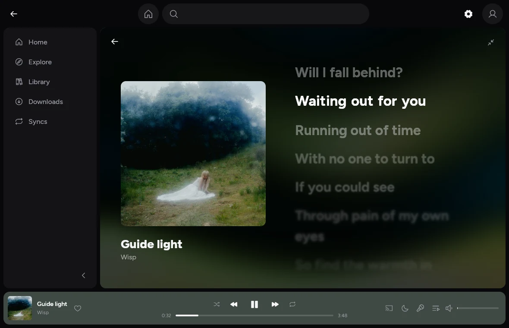
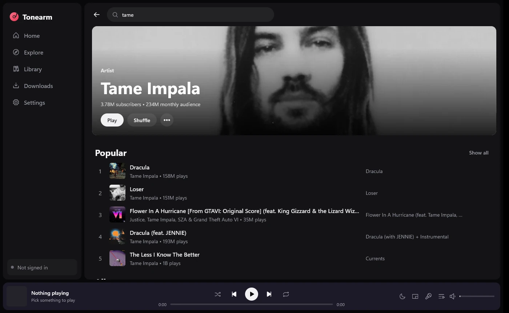
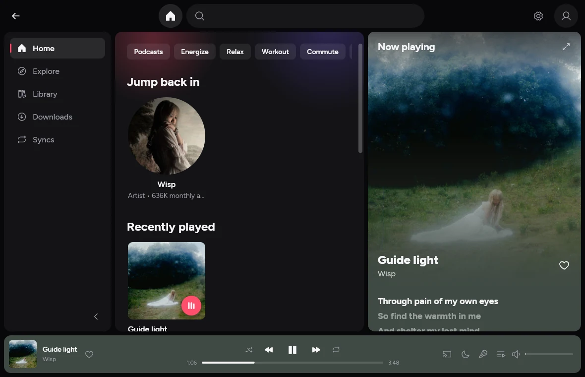
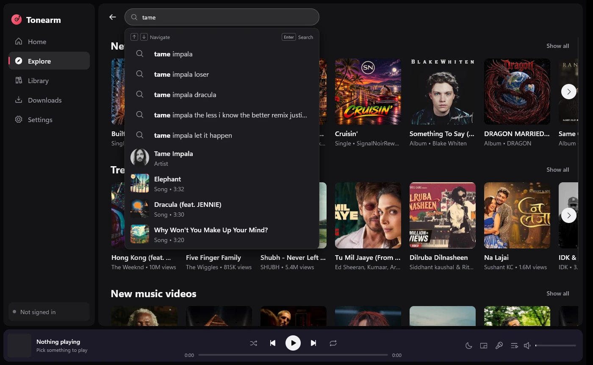
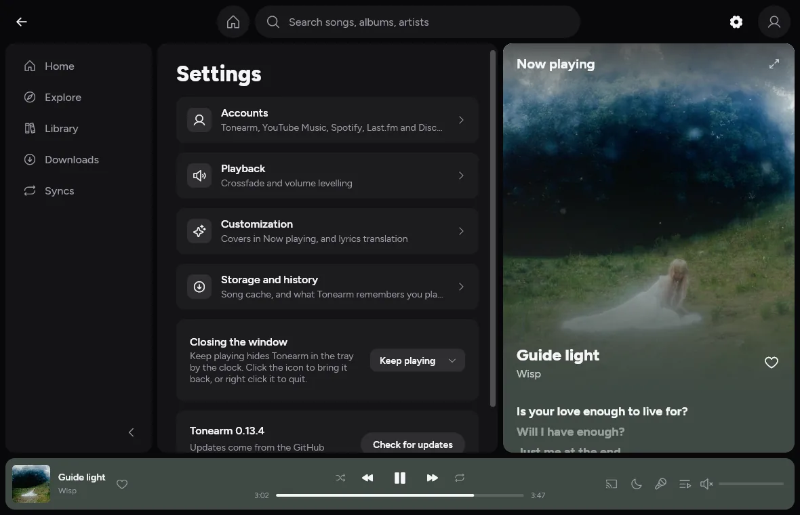

# Tonearm

A native client for YouTube Music on Windows and Android, written in Rust.

Tonearm has no web view and no browser engine. The desktop app draws its own
UI with [Slint](https://slint.dev) and Skia, the phone app is Kotlin and
Jetpack Compose, and both run the same Rust core that talks to YouTube Music
over plain HTTPS, so they start fast and stay small in memory.

**Website: [tonearm.eli-zac.dev](https://tonearm.eli-zac.dev)**



> [!IMPORTANT]
> Tonearm is an unofficial, independent project. It is not affiliated with,
> endorsed by or sponsored by Google, YouTube or Spotify. YouTube Music is a
> trademark of Google LLC, and Spotify is a trademark of Spotify AB. Using
> Tonearm may go against YouTube's Terms of Service, and you use it at your
> own risk.

## Features

* Home, Explore, search, and artist, album and playlist pages
* Your library, liked songs and playlists, once you sign in
* A queue you can drag to reorder, radio, smart shuffle, and autoplay when
  the queue runs out
* Crossfade, which can also apply when you skip or pick another song,
  volume levelling and a sleep timer
* Casting to Chromecasts, Google TVs, Nest speakers and speaker groups,
  with mixes and crossfades intact
* Synced lyrics, timed by the syllable where the source allows, with duet
  sides and out of focus lines
* A Now playing panel with animated covers and Spotify Canvas clips
* Songs kept on your computer to play offline, and a cache so songs you
  play again start at once
* Picks up where you left off: the queue, the song and the position
* Windows media keys, the media flyout, and play controls under the
  taskbar preview
* Closes to the tray and keeps playing, if you want it to
* Discord Rich Presence and Last.fm scrobbling
* A phone app for Android, with Android Auto and Galaxy Watch controls
* A Tonearm account: your settings and pins follow you from computer to
  phone
* In-app updates, on the computer and the phone

## Screenshots

| | |
|---|---|
|  |  |
| Artist pages | Home and the Now playing panel |
|  |  |
| Search as you type | Settings |

Tonearm is young. Expect rough edges, and please report what breaks.

## Install

### Windows

Download `Tonearm-<version>-setup.exe` from the
[latest release](../../releases/latest) and run it. It installs just for
you, in `%LOCALAPPDATA%\Programs\Tonearm`, and needs no admin rights. You
can uninstall it from Settings > Apps like any other app.

The installer is not code signed, so Windows SmartScreen may warn the
first time. Pick "More info", then "Run anyway".

### Android

Download `Tonearm-<version>.apk` from the
[latest release](../../releases/latest) and open it. Android 8 or later.
Your browser or file manager asks to allow installing apps from it, the
first time only. Sign in to YouTube Music inside the app. The phone app
checks for a newer release at start and installs it from Settings.

### Updates

On the computer, Tonearm checks for a new release at start up and shows a note when one is
out. Settings has an Updates card too. Installing downloads the new
installer, checks its SHA-256 against the digest GitHub publishes, then
closes Tonearm, installs the update and starts it again.

## Sign in

Tonearm cannot show Google's sign in page, because that needs a browser.
It uses your browser's session instead.

1. Sign in to music.youtube.com in your browser.
2. Open the developer tools and pick the Network tab.
3. Click any request to music.youtube.com.
4. Copy the value of the `Cookie` request header.
5. Paste it into Settings in Tonearm.

> [!WARNING]
> That cookie gives full access to your Google account. Never share it or
> paste it anywhere else.

Tonearm encrypts the cookie with Windows DPAPI, so only your Windows
account can read it, and sends it only to music.youtube.com.

## How playback works

YouTube has no public API that hands out audio streams. Tonearm asks
YouTube's own InnerTube `player` endpoint for a stream link, the way
YouTube's apps do, and picks the AAC audio. Some links come locked with a
challenge from YouTube's player script, so Tonearm runs that script in an
embedded QuickJS with [yt-dlp's ejs solver](https://github.com/yt-dlp/ejs).
Nothing else is downloaded or installed, and the computer and the phone
work the same way. YouTube changes how this works every so often, and
the clients Tonearm asks as follow the ones yt-dlp uses.

The resolver lives behind one trait in `crates/tonearm-core/src/resolver.rs`. Set
`TONEARM_TEST_STREAM` to any M4A URL to test the audio path without it.

## Casting

The cast button by the sleep timer lists the Google Cast devices on your
network. The device plays Tonearm's own output as a live stream from your
computer, so crossfades, mixes and offline songs all carry over. Pausing is
heard at once, skips and seeks within about a second, and the computer has to stay on.

The device fetches the stream from your computer, so Windows Firewall asks
the first time you cast. If casting fails with "couldn't reach this
computer", allow Tonearm in that prompt, or set your network to private in
Windows settings: Windows blocks incoming connections on public networks.

`tonearm --probe cast` lists the devices found and what each is running,
without changing anything on them.

Speakers play through Google's Default Media Receiver. Devices with a
screen can use Tonearm's own receiver instead, `receiver/public/index.html`,
which shows each song's cover, title, artist and progress. It is Cast app
`79497171`, served from `https://tonearm-cast.eli-zac.dev/` by a Cloudflare
Worker (`cd receiver && npx wrangler deploy` to update it). A build uses it
unless `TONEARM_CAST_APP` (in `keys.env` or the environment) names another id.
Until the app is published, only devices registered in the Cast developer
console can open it; any other device falls back to Google's receiver.

## Lyrics

Tonearm asks these public lyric services in order, and stops at the first
one that has the track.

1. lrc.red, syllable timed
2. BetterLyrics, syllable timed
3. LRCLIB, line timed
4. YouTube Music's own lyrics, plain text

## Discord, Last.fm and Spotify

Open Settings, then Connections. Each service has its own card.

Release builds carry Tonearm's own Discord application and Last.fm keys,
so you only press Connect. Discord needs no sign in. Last.fm opens a page
in your browser where you approve Tonearm.

On Android, Discord is under Settings, Accounts. It uses Discord's Social
SDK, so the Discord app must be installed and signed in on the phone. The
SDK is Discord's own and is not in this repository (its open source notices
are, in `android/app/libs`). To build the phone app, download Discord's
Social SDK for Android and put `discord_partner_sdk.aar` in
`android/app/libs`.

Spotify is optional, and needs a client ID and client secret of your own
from developer.spotify.com. With them, Tonearm looks each track up on
Spotify and reports Spotify's title, artist and album to Last.fm and
Discord. Without a sure match it reports the YouTube Music names. Canvas
clips also need a Spotify web sign in, which Connections explains.

A track scrobbles after it has played for half its length or four minutes,
as Last.fm asks.

## Your data

Everything stays on your computer, unless you make a Tonearm account.

A Tonearm account is optional. With one, Tonearm's server
(`api.tonearm.eli-zac.dev`, a Cloudflare Worker in `server/`) keeps your
email address, the list of your signed-in devices (name, kind and model),
and the settings and pins that sync between them. It never gets your
YouTube Music sign in, your listening history or your music. Without an
account nothing is sent to it.

* Settings, the sign in cookie and service keys are in
  `%APPDATA%\tonearm`, all encrypted with DPAPI.
* Offline songs, the song cache and Canvas clips are in
  `%LOCALAPPDATA%\tonearm`.
* Listening history is kept encrypted on this computer, only to put what
  you play first in search. Settings can clear it.

Tonearm talks to YouTube Music, the lyric services above, GitHub (for
updates), and Discord, Last.fm and Spotify only when you connect
them. Uninstalling keeps your data, in case you come back. Delete the two
folders above to remove it.

## Build

You need Windows and a recent stable Rust. The phone app also needs the
Android SDK and NDK, `cargo-ndk` and JDK 21: run `android\build-rust.ps1`
for the core, then `gradlew installDebug` in `android/`.

```bash
cargo build --release
```

The binary lands in `target/release/tonearm.exe`. For quicker optimised
builds while working, `cargo build --profile fast` skips link time
optimisation.

To build the installer as well, install [NSIS](https://nsis.sourceforge.io)
and run this from the repository root.

```bash
makensis -DVERSION=0.6.0 installer/tonearm.nsi
```

It writes `Tonearm-0.6.0-setup.exe` next to `Cargo.toml`.

### Service keys

Tonearm's own Discord and Last.fm keys are not in this repository. The
build reads them from the environment, or from a `keys.env` file next to
`Cargo.toml` that git ignores:

```
TONEARM_DISCORD_APP=your application ID from discord.com/developers
TONEARM_LASTFM_KEY=your API key from last.fm/api/account/create
TONEARM_LASTFM_SECRET=the shared secret that comes with it
```

A build without them works too. Connections then asks for your own keys.

### Releases

Push a version tag such as `v0.11.0`. Two workflows run. Release builds
the Windows app and its installer and creates the GitHub release, reading
the three keys above from the repository secrets. Android release builds the
phone app and attaches `Tonearm-<version>.apk` to that release. It needs
`ANDROID_KEYSTORE_BASE64`, `ANDROID_KEYSTORE_PASSWORD`, `ANDROID_KEY_ALIAS`
and `ANDROID_KEY_PASSWORD`, the release key's details. A manual run of
Android release with publish off builds the APK as an artifact without
touching a release. The landing page in `site/` deploys with
`cd site && npx wrangler deploy`.

## Layout

`crates/tonearm-core` is everything that is not the window, and the desktop
app at the top and the phone app in `android/` (through
`crates/tonearm-android`) both use it.

| Path | What it holds |
| --- | --- |
| `ui/app.slint` | The whole interface |
| `src/main.rs` | App state and wiring |
| `src/blur.rs`, `src/images.rs` | Lyric lines drawn out of focus, and covers |
| `src/canvas.rs`, `src/motion.rs` | Spotify Canvas clips and animated covers |
| `src/casting.rs`, `src/downloading.rs` | The Devices panel, and download toasts and storage |
| `src/media_keys.rs`, `src/taskbar.rs`, `src/shell.rs` | Media keys, taskbar buttons, tray and Start menu shortcut |
| `src/update.rs` | In-app updates |
| `crates/tonearm-core/src/innertube/` | YouTube Music API client and parsers |
| `crates/tonearm-core/src/audio.rs`, `decode.rs` | Streaming download, decode and output |
| `crates/tonearm-core/src/mix.rs`, `transition.rs`, `analysis.rs` | Mixes, and the tempo and key analyzer |
| `crates/tonearm-core/src/resolver.rs` | Turns a song into an audio stream link |
| `crates/tonearm-core/src/lyrics.rs` | Lyric services |
| `crates/tonearm-core/src/services.rs`, `spotify.rs`, `syncing.rs` | Discord, Last.fm, Spotify and playlist sync |
| `crates/tonearm-core/src/offline.rs` | Offline songs and the song cache |
| `crates/tonearm-core/src/cast/` | Finding Cast devices and streaming to them |
| `crates/tonearm-core/src/history.rs`, `session.rs` | Listening history, and where you left off |
| `crates/tonearm-core/src/store.rs` | Encrypted storage for settings and secrets |
| `crates/tonearm-core/src/account.rs`, `settings_sync.rs` | The Tonearm account client, and syncing settings and pins with it |
| `crates/tonearm-android/` | The bridge the phone app calls the core through (UniFFI) |
| `android/` | The phone app: Kotlin and Jetpack Compose |
| `server/` | The Tonearm account server: a Cloudflare Worker with a D1 database |
| `site/` | The landing page, tonearm.eli-zac.dev |
| `receiver/` | Tonearm's own Cast receiver |
| `installer/tonearm.nsi` | The NSIS installer |

## Contributing

Bug reports and pull requests are welcome. For anything large, please open
an issue first so we can talk it through.

## Licence

Tonearm is free software under the GNU General Public License, version 3.
See [LICENSE](LICENSE).

Tonearm uses Slint under its GPLv3 licence. Bar starts are found with the
Beat This! model, under the MIT licence, run through ONNX Runtime; see
[THIRD_PARTY_NOTICES.md](THIRD_PARTY_NOTICES.md). The icons are from
[Phosphor](https://phosphoricons.com), under the MIT licence in
`ui/icons-LICENSE.txt`.
